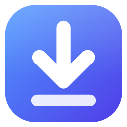
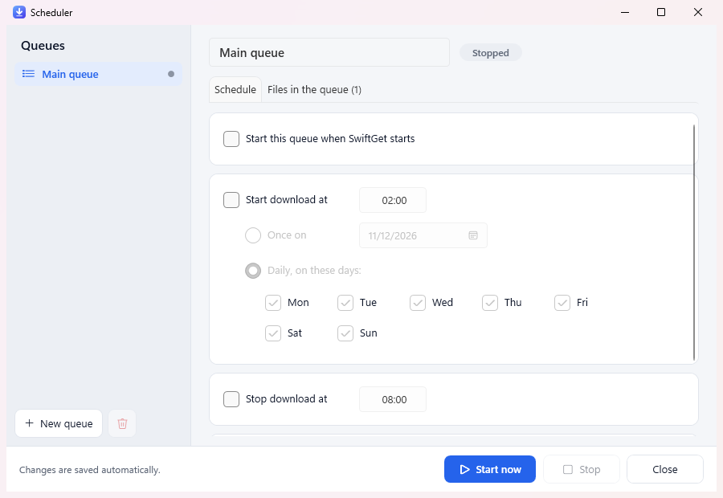
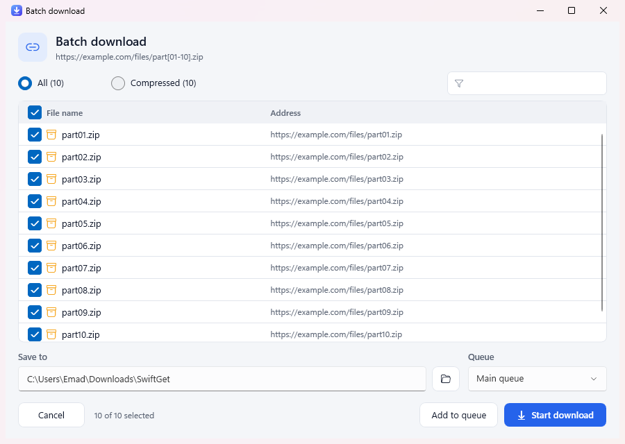

<p align="center">
  
</p>

<h1 align="center">SwiftGet</h1>

<p align="center">
  A fast, free and open-source download manager for Windows.<br>
  Multi-connection downloads · Resume · Queue &amp; scheduler · Browser integration · English &amp; فارسی · Light &amp; dark
</p>

<p align="center">
  <a href="https://github.com/EmadNajafi/SwiftGet-Download-Manager/releases/latest"><b>⬇ Download the latest version</b></a>
  &nbsp;·&nbsp; <a href="#فارسی">راهنمای فارسی</a>
</p>


<p align="center">&nbsp;</p>

<p align="center"></p>

## Features

**Downloading**
- **Multi-connection downloads** (up to 32) with dynamic splitting, **pause and resume**, automatic retries and a speed limiter.
- **HTTP, HTTPS and FTP**, including resume and multiple connections over FTP.
- **Video streams (HLS / m3u8)**: picks the best quality, decrypts AES-128 streams and joins the parts. With [ffmpeg](https://ffmpeg.org) installed, streams are saved as MP4 and separate audio is merged in; without it they're saved as `.ts`.
- **Refresh download address**: when a link expires, paste a new one (or click it again in the browser) and the download continues where it stopped.
- **Batch download**: `file[001-100].zip`, `part[a-f].rar` or `file*.zip` with a range.
- **Site grabber**: explore a website and collect the files it links to.
- **Clipboard monitor**: copy a link to a file and SwiftGet offers to download it.

**Organizing**
- **Queues and scheduler**: as many queues as you like, each with its own start time (once or daily), stop time, parallel downloads and file order. When a queue finishes SwiftGet can exit, sleep, hibernate or shut down the PC (with a cancellable countdown).
- **Synchronization queues**: check finished files for changes on the server and download them again.
- **Automatic categories**, category tree, search, sortable table, import and export of the download list.

**Browser integration** (Chrome, Edge, Brave, Opera, Firefox)
- Downloads are caught automatically and sent with cookies and referrer, so downloads that need a login work.
- A **"Download this video" button** appears over videos; the toolbar popup lists every video and audio file found on the page.
- Right-click → **Download with SwiftGet** or **Download all links with SwiftGet**.

**Connection and safety**
- Windows proxy, no proxy, or your own proxy (with user name and password).
- **Site logins** for sites and FTP servers that need a user name and password (stored encrypted with Windows DPAPI).
- Downloaded files are marked as coming from the internet (like browsers do), and can be scanned with Microsoft Defender or another antivirus.

**App**
- Classic, familiar layout with a menu bar, big-icon toolbar and progress window with per-connection details.
- English and Persian with full right-to-left layout and Solar Hijri dates; light and dark themes.
- Starts with Windows, lives in the notification area, and **updates itself** from GitHub Releases.
<p align="center"></p>

## Install

1. Download **`SwiftGet-Setup-x.y.z.exe`** from the [latest release](https://github.com/EmadNajafi/SwiftGet-Download-Manager/releases/latest) and run it. Administrator rights aren't needed.
2. Windows may show *"Windows protected your PC"* because the installer isn't code-signed. Click **More info → Run anyway**.

You can also use the **portable zip** from the same page: unzip it anywhere and run `SwiftGet.exe`.

Requirements: Windows 10 (1809) or Windows 11, 64-bit. Nothing else needs to be installed.

### Browser extension

The extension sends browser downloads to SwiftGet, adds **Download with SwiftGet** to the right-click menu, and lists the **videos and audio** playing on a page so you can save them with one click. You can choose which file types to catch, a minimum size and sites to skip.

1. In SwiftGet open **Options → Browser** and click **Add to Chrome** (or Edge, Brave, Opera, Firefox).
2. A short guide opens in the browser and the extension folder opens in Explorer. The address of the extensions page is already copied, so paste it into the address bar.
3. Turn on **Developer mode** and drag the `extension` folder onto the page.

SwiftGet shows **The extension is connected** within a minute. When SwiftGet isn't running, downloads simply stay in the browser.

Firefox loads it as a temporary add-on (until Firefox restarts) until the Firefox version is signed by Mozilla, which is free; see [docs/PUBLISHING.md](docs/PUBLISHING.md).

> Once the extension is published in the Chrome Web Store and Edge Add-ons, the installer adds it automatically. See [docs/PUBLISHING.md](docs/PUBLISHING.md).

### Starts with Windows

SwiftGet starts with Windows and waits in the notification area, so browser downloads and scheduled queues always work. You can turn this off during setup or in **Options → General**.
## Build from source

Requirements: [.NET 10 SDK](https://dotnet.microsoft.com/download) and, for the installer, [Inno Setup 6](https://jrsoftware.org/isinfo.php) (`winget install JRSoftware.InnoSetup`).

```powershell
git clone https://github.com/EmadNajafi/SwiftGet-Download-Manager.git
cd SwiftGet-Download-Manager
dotnet run --project SwiftGet          # run from source
.\build.ps1 -Version 1.0.0             # dist\SwiftGet-Setup-1.0.0.exe + portable zip
```

Pushing a tag like `v1.0.1` builds the installer on GitHub Actions and publishes a release automatically.

### Publishing a new version

1. Raise `<Version>` in `SwiftGet/SwiftGet.csproj` (and `"version"` in `extension/manifest.json` if the extension changed).
2. Commit, then `git tag v2.1.0` and `git push origin main --tags`. GitHub Actions builds the installer and creates the release; write what changed in the release notes.
3. Running copies of SwiftGet check GitHub every 6 hours. They show a notification and a banner, and install the update with one click.

### Project layout

| Path | What it does |
|---|---|
| `SwiftGet/Core/DownloadEngine.cs` | Probing, multi-connection download, resume, retries |
| `SwiftGet/Core/DownloadManager.cs` | Download list, queue, scheduler, saving state |
| `SwiftGet/Core/BrowserBridge.cs` | Local endpoint on `127.0.0.1:47321` for the extension (requests from web pages are refused) |
| `SwiftGet/Core/Strings.cs` | All UI text in English and Persian |
| `SwiftGet/Themes/` | Light and dark color palettes |
| `SwiftGet/Views/` | Windows |
| `extension/` | Browser extension (Manifest V3) |
| `installer/` | Inno Setup script |
| `tools/IconGen/` | Draws the app, extension and installer icons |

Settings and the download list are stored in `%APPDATA%\SwiftGet`.

### Adding a language

Add a table to `SwiftGet/Core/Strings.cs` with the same keys as `En`, then add it to the language list in `SettingsWindow.xaml.cs`. Pull requests are welcome.

## License

[MIT](LICENSE)

---

<div dir="rtl" id="فارسی">

## فارسی

**SwiftGet** یک برنامهٔ مدیریت دانلود سریع، رایگان و متن‌باز برای ویندوز است.

### قابلیت‌ها

- **دانلود چندبخشی**: هر فایل به چند بخش تقسیم می‌شود و بخش‌ها هم‌زمان دانلود می‌شوند (پیش‌فرض ۸ اتصال، تا ۳۲ اتصال).
- **توقف و ادامهٔ دانلود** پس از قطع اینترنت، توقف یا خاموش شدن سیستم.
- **تلاش دوبارهٔ خودکار** هنگام خطای شبکه.
- **ویدیوهای استریم (HLS / m3u8)** با انتخاب بهترین کیفیت و پشتیبانی از رمزنگاری AES-128.
- **به‌روزرسانی آدرس دانلود** برای لینک‌های منقضی‌شده، **دانلود گروهی**، **جمع‌آوری فایل از سایت**، **زیر نظر گرفتن کلیپ‌بورد** و پشتیبانی **FTP**.
- **دکمهٔ «دانلود این ویدیو»** روی ویدیوهای سایت‌ها و **دانلود همهٔ لینک‌های صفحه**.
- **پروکسی دلخواه**، **نام کاربری سایت‌ها**، اسکن با ضدویروس و **به‌روزرسانی خودکار برنامه**.
- **چند صف و زمان‌بندی**: هر تعداد صف با ساعت شروع (یک بار یا روزانه) و توقف، تعداد دانلود هم‌زمان و ترتیب فایل‌ها؛ و پس از پایان صف: بستن برنامه، Sleep، Hibernate یا خاموش کردن کامپیوتر.
- **محدودیت سرعت**.
- **دسته‌بندی خودکار** فایل‌ها (ویدیو، موسیقی، اسناد، فشرده، برنامه‌ها، تصاویر).
- **افزونهٔ مرورگر** برای Chrome، Edge، Brave و Opera. دانلودها همراه با کوکی‌ها گرفته می‌شوند، پس لینک‌هایی که ورود به حساب لازم دارند هم دانلود می‌شوند.
- **ظاهر مدرن ویندوز ۱۱** با پوستهٔ روشن و تیره.
- **رابط فارسی و انگلیسی** با چیدمان کامل راست‌به‌چپ و تاریخ شمسی.
- بدون تبلیغ و بدون ارسال اطلاعات کاربر.

### نصب

۱. فایل **SwiftGet-Setup** را از [صفحهٔ آخرین نسخه](https://github.com/EmadNajafi/SwiftGet-Download-Manager/releases/latest) دانلود و اجرا کنید. به دسترسی مدیر (Administrator) نیازی نیست.

۲. چون فایل نصبی امضای دیجیتال ندارد، ممکن است ویندوز پیام «Windows protected your PC» نشان دهد. روی **More info** و سپس **Run anyway** بزنید.

۳. برای تغییر زبان به **تنظیمات ← ظاهر** بروید.

### افزونهٔ مرورگر

افزونه دانلودهای مرورگر را به SwiftGet می‌فرستد و ویدیو و صدای در حال پخش در صفحه را هم نشان می‌دهد تا با یک کلیک دانلود شوند. SwiftGet همراه ویندوز اجرا می‌شود و کنار ساعت منتظر می‌ماند.

### نصب افزونهٔ مرورگر

۱. در SwiftGet به **تنظیمات ← مرورگر** بروید و روی «افزودن به Chrome» (یا Edge) بزنید. راهنما و پوشهٔ افزونه باز می‌شوند و آدرس صفحهٔ افزونه‌ها کپی می‌شود.

۲. آدرس کپی‌شده را در نوار آدرس مرورگر بچسبانید.

۳. گزینهٔ **Developer mode** را روشن کنید و پوشهٔ `extension` را روی صفحه بکشید.

</div>
