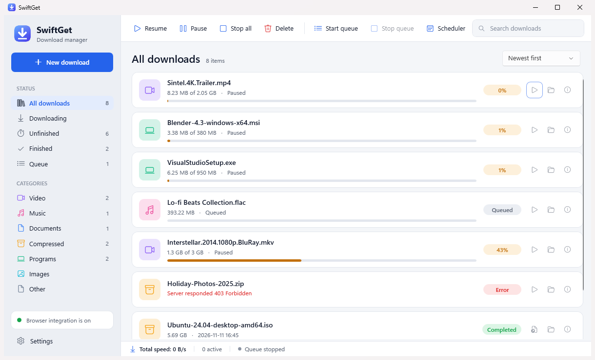
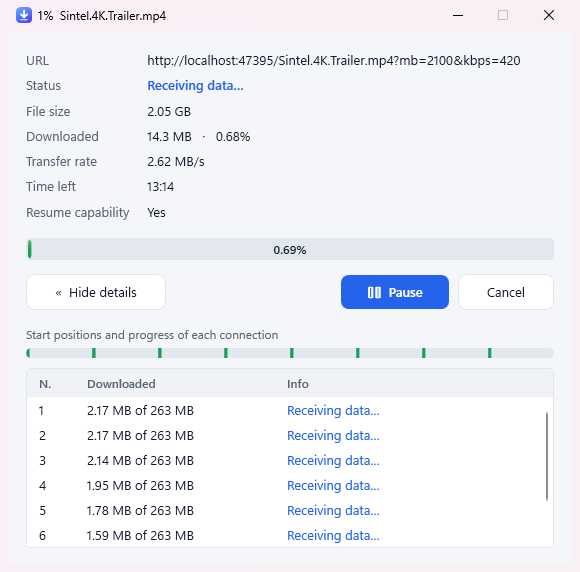
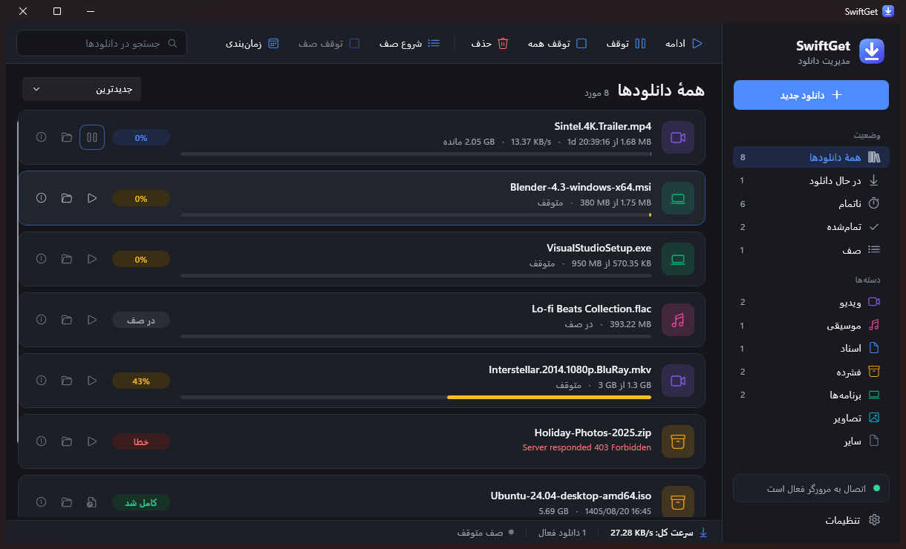

<p align="center">
  
</p>

<h1 align="center">SwiftGet</h1>

<p align="center">
  A fast, free and open-source download manager for Windows.<br>
  Multi-connection downloads · Resume · Queue &amp; scheduler · Browser integration · English &amp; فارسی · Light &amp; dark
</p>

<p align="center">
  <a href="https://github.com/EmadNajafi/SwiftGet-Download-Manager/releases/latest"><b>⬇ Download the latest version</b></a>
  &nbsp;·&nbsp; <a href="#فارسی">راهنمای فارسی</a>
</p>



<p align="center">&nbsp;</p>

## Features

- **Multi-connection downloads** – each file is split into parts that download in parallel (8 connections by default, up to 32). When a connection finishes early it takes over half of the largest remaining part, so every connection stays busy until the end.
- **Pause and resume** – continue after a pause, a dropped connection or a restart, from exactly where you stopped.
- **Automatic retries** on network errors.
- **Queues and scheduler** – create as many queues as you like, each with its own start time (once on a date or daily on chosen days), stop time, number of files downloading at once and file order. When a queue finishes SwiftGet can exit, sleep, hibernate or shut down the PC (with a 30-second countdown you can cancel).
- **Speed limiter** for all downloads.
- **Automatic categories** – Video, Music, Documents, Compressed, Programs, Images – each saved in its own folder.
- **Browser integration** for Chrome, Edge, Brave and Opera. Downloads are caught automatically and sent with the browser's cookies and referrer, so downloads that need a login work too. Right-click any link → *Download with SwiftGet*.
- **Modern Windows 11 look** with light and dark themes that follow your Windows setting.
- **English and Persian (فارسی)** interface with full right-to-left layout and Solar Hijri dates.
- Notification-area icon, completion pop-up, search and sorting.
- Uses your Windows proxy settings. No telemetry and no ads.

<p align="center"></p>

## Install

1. Download **`SwiftGet-Setup-x.y.z.exe`** from the [latest release](https://github.com/EmadNajafi/SwiftGet-Download-Manager/releases/latest) and run it. Administrator rights aren't needed.
2. Windows may show *"Windows protected your PC"* because the installer isn't code-signed. Click **More info → Run anyway**.

You can also use the **portable zip** from the same page: unzip it anywhere and run `SwiftGet.exe`.

Requirements: Windows 10 (1809) or Windows 11, 64-bit. Nothing else needs to be installed.

### Browser extension

The extension sends browser downloads to SwiftGet, adds **Download with SwiftGet** to the right-click menu, and lists the **videos and audio** playing on a page so you can save them with one click. You can choose which file types to catch, a minimum size and sites to skip.

1. In SwiftGet open **Options → Browser** and click **Add to Chrome** (or Edge, Brave, Opera).
2. A short guide opens in the browser and the extension folder opens in Explorer. The address of the extensions page is already copied, so paste it into the address bar.
3. Turn on **Developer mode** and drag the `extension` folder onto the page.

SwiftGet shows **The extension is connected** within a minute. When SwiftGet isn't running, downloads simply stay in the browser.

> Once the extension is published in the Chrome Web Store and Edge Add-ons, the installer adds it automatically. See [docs/PUBLISHING.md](docs/PUBLISHING.md).

### Starts with Windows

SwiftGet starts with Windows and waits in the notification area, so browser downloads and scheduled queues always work. You can turn this off during setup or in **Options → General**.
## Build from source

Requirements: [.NET 10 SDK](https://dotnet.microsoft.com/download) and, for the installer, [Inno Setup 6](https://jrsoftware.org/isinfo.php) (`winget install JRSoftware.InnoSetup`).

```powershell
git clone https://github.com/EmadNajafi/SwiftGet-Download-Manager.git
cd SwiftGet-Download-Manager
dotnet run --project SwiftGet          # run from source
.\build.ps1 -Version 1.0.0             # dist\SwiftGet-Setup-1.0.0.exe + portable zip
```

Pushing a tag like `v1.0.1` builds the installer on GitHub Actions and publishes a release automatically.

### Project layout

| Path | What it does |
|---|---|
| `SwiftGet/Core/DownloadEngine.cs` | Probing, multi-connection download, resume, retries |
| `SwiftGet/Core/DownloadManager.cs` | Download list, queue, scheduler, saving state |
| `SwiftGet/Core/BrowserBridge.cs` | Local endpoint on `127.0.0.1:47321` for the extension (requests from web pages are refused) |
| `SwiftGet/Core/Strings.cs` | All UI text in English and Persian |
| `SwiftGet/Themes/` | Light and dark color palettes |
| `SwiftGet/Views/` | Windows |
| `extension/` | Browser extension (Manifest V3) |
| `installer/` | Inno Setup script |
| `tools/IconGen/` | Draws the app, extension and installer icons |

Settings and the download list are stored in `%APPDATA%\SwiftGet`.

### Adding a language

Add a table to `SwiftGet/Core/Strings.cs` with the same keys as `En`, then add it to the language list in `SettingsWindow.xaml.cs`. Pull requests are welcome.

## License

[MIT](LICENSE)

---

<div dir="rtl" id="فارسی">

## فارسی

**SwiftGet** یک برنامهٔ مدیریت دانلود سریع، رایگان و متن‌باز برای ویندوز است.

### قابلیت‌ها

- **دانلود چندبخشی**: هر فایل به چند بخش تقسیم می‌شود و بخش‌ها هم‌زمان دانلود می‌شوند (پیش‌فرض ۸ اتصال، تا ۳۲ اتصال).
- **توقف و ادامهٔ دانلود** پس از قطع اینترنت، توقف یا خاموش شدن سیستم.
- **تلاش دوبارهٔ خودکار** هنگام خطای شبکه.
- **چند صف و زمان‌بندی**: هر تعداد صف با ساعت شروع (یک بار یا روزانه) و توقف، تعداد دانلود هم‌زمان و ترتیب فایل‌ها؛ و پس از پایان صف: بستن برنامه، Sleep، Hibernate یا خاموش کردن کامپیوتر.
- **محدودیت سرعت**.
- **دسته‌بندی خودکار** فایل‌ها (ویدیو، موسیقی، اسناد، فشرده، برنامه‌ها، تصاویر).
- **افزونهٔ مرورگر** برای Chrome، Edge، Brave و Opera. دانلودها همراه با کوکی‌ها گرفته می‌شوند، پس لینک‌هایی که ورود به حساب لازم دارند هم دانلود می‌شوند.
- **ظاهر مدرن ویندوز ۱۱** با پوستهٔ روشن و تیره.
- **رابط فارسی و انگلیسی** با چیدمان کامل راست‌به‌چپ و تاریخ شمسی.
- بدون تبلیغ و بدون ارسال اطلاعات کاربر.

### نصب

۱. فایل **SwiftGet-Setup** را از [صفحهٔ آخرین نسخه](https://github.com/EmadNajafi/SwiftGet-Download-Manager/releases/latest) دانلود و اجرا کنید. به دسترسی مدیر (Administrator) نیازی نیست.

۲. چون فایل نصبی امضای دیجیتال ندارد، ممکن است ویندوز پیام «Windows protected your PC» نشان دهد. روی **More info** و سپس **Run anyway** بزنید.

۳. برای تغییر زبان به **تنظیمات ← ظاهر** بروید.

### افزونهٔ مرورگر

افزونه دانلودهای مرورگر را به SwiftGet می‌فرستد و ویدیو و صدای در حال پخش در صفحه را هم نشان می‌دهد تا با یک کلیک دانلود شوند. SwiftGet همراه ویندوز اجرا می‌شود و کنار ساعت منتظر می‌ماند.

### نصب افزونهٔ مرورگر

۱. در SwiftGet به **تنظیمات ← مرورگر** بروید و روی «افزودن به Chrome» (یا Edge) بزنید. راهنما و پوشهٔ افزونه باز می‌شوند و آدرس صفحهٔ افزونه‌ها کپی می‌شود.

۲. آدرس کپی‌شده را در نوار آدرس مرورگر بچسبانید.

۳. گزینهٔ **Developer mode** را روشن کنید و پوشهٔ `extension` را روی صفحه بکشید.

</div>
